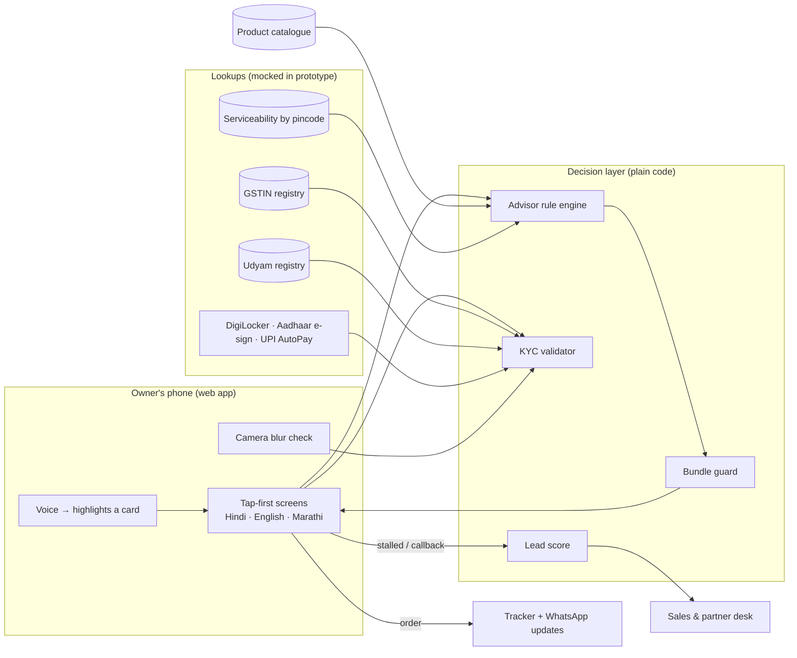

# Udyam Digital · Accel Business

**From 17 days and 3 visits to 10 minutes and zero paperwork: by tapping, in your language.**

A phone-first onboarding journey for small businesses (YTL Hackathon 2026, Enterprise Track A, *Project Udyam Digital*). A shop owner picks a bundle, gets one transparent monthly price, completes KYC mostly by lookup, books installation, and tracks the order without calling anyone.

All data is synthetic and comes from the hackathon pack. "Accel Telecom" is the case's fictional operator.

## What's in the prototype

| View | What it does |
| --- | --- |
| **Owner app** (`#app`) | Language → phone OTP → business type → GSTIN lookup → size → pincode serviceability → today's setup → needs → plan (Basic / Recommended / Complete) → consent → smart KYC → install slot + UPI AutoPay → order tracker with WhatsApp updates |
| **KYC check** (`#kyc`) | The 12 specimen applicants (K01–K12), OCR-read and validated against the mock GST and Udyam registries, with plain-language results |
| **Sales & partner desk** (`#desk`) | Callback queue ranked by a lead score, assisted sign-up for partners and field sales, drop-off analysis, rule-breach comparison, segment economics |

Hindi and English are complete; Marathi covers the first screens and falls back to Hindi. Seven more languages from the leads data are listed as coming soon.

### Demo shortcuts

- Phone `9810000001` = existing Accel mobile customer (ID reused, no upload). OTP is `123456`.
- Sample GSTINs on the GST screen: active, cancelled, and one with an altered character.
- Pincode `400008` = area without fibre (switches the plan to 5G AirFiber).
- On a wide screen, the **Behind the screen** panel explains the rule at work on each step.

## The design rule: AI listens and reads, rules decide

Nothing a customer sees is generated by a model, so nothing can be hallucinated.

| Job | How | Why |
| --- | --- | --- |
| Understanding the owner | Tap-only cards and chips; optional voice that *highlights* a card for the owner to confirm | No free text for an AI to misread |
| Choosing products and prices | Rule engine over the catalogue (`src/engine/advisor.js`) | Every product, price and quantity comes from `product_catalogue.csv` |
| Guarding the result | `verifyBundle()` re-checks every bundle against every rule before it's shown | Second, independent check |
| Explaining | Pre-written, pre-translated sentences filled with the plan's own numbers | Can't invent a price or promise |
| Reading documents | Tesseract OCR, plus blur and tilt measurement | OCR only extracts text |
| KYC decisions | Plain code: GSTIN check digit, registry status, name/address match, 90-day bill age | Auditable, repeatable |
| Who to call first | Logistic regression on the 5,000 leads (5-fold AUC 0.72), with the factors shown | Explainable to a sales agent |

### Proof (run `npm test`)

```
Replay: 5000 leads → 15000 bundles, 0 eligibility violations, 752 requests shown as locked with a reason
K01  action    fail:gstinStatus, warn:udyamBlankNotFound
K02  verified  info:deskewed
K04  action    fail:blurry
K06  action    fail:gstinInvalid
K07  action    fail:legalNameMismatch
K11  action    fail:billTooOld
...
All tests passed
```

The current sales process, in the same data, sold **53 bundles that broke catalogue rules** and activated **22 customers on cancelled or suspended GSTINs**.

## Architecture



In production, the mocked lookups map to services that exist today: GST verification via a GST Suvidha Provider, Udyam verification, DigiLocker, Aadhaar eSign, UPI AutoPay mandates, and the operator's own network-inventory API for serviceability.

## Run it

```bash
npm install
npm run dev          # http://localhost:5173
npm test             # KYC specimen checks; also replays all 5,000 leads when data-raw/ is present
npm run build        # dist/ for static hosting
```

To regenerate the data pack, unzip `YTL_TrackA_Udyam_Digital_Data.zip` into `data-raw/` (it is not committed: the case asks teams to treat it like real customer data). Then run, with Python 3, pandas, scikit-learn, Pillow and the `tesseract` CLI installed:

```bash
npm run data
```

## Project layout

```
src/engine/advisor.js   rule engine, bundle builder, guard
src/engine/kyc.js       GSTIN checksum + OCR repair, registry lookups, applicant validation, blur measure
src/engine/score.js     lead score
src/CustomerApp.jsx     owner journey
src/KycLab.jsx          K01–K12 validation view
src/SalesDesk.jsx       sales and partner desk
src/i18n.js             every customer-facing sentence, per language
scripts/prepare_data.py builds src/data/*.json and public/kyc/*.jpg from data-raw/
tests/run-all.mjs       replay and KYC tests
docs/PRIVACY.md         1-page privacy and security note
```

## Privacy

See [docs/PRIVACY.md](docs/PRIVACY.md). In short: one purpose-specific consent, lookups instead of uploads, address proof skipped when installing at the GST address, identifiers masked in the UI, documents deleted 90 days after activation, and the raw leads file is never shipped to the browser.
