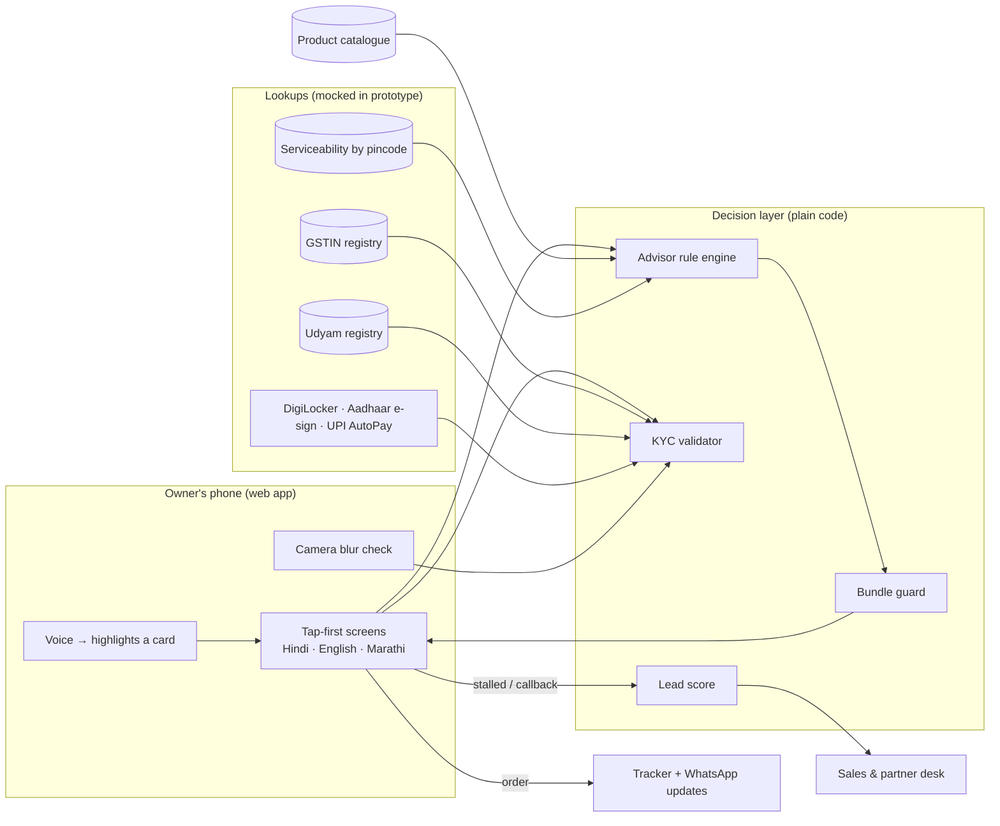

# Udyam Digital · Accel Business

**From 17 days and 3 visits to 10 minutes and zero paperwork: by tapping, in your language.**

A phone-first onboarding journey for small businesses (YTL Hackathon 2026, Enterprise Track A, *Project Udyam Digital*). A shop owner picks a bundle, gets one transparent monthly price, completes KYC mostly by lookup, books installation, and tracks the order without calling anyone.

All data is synthetic and comes from the hackathon pack. "Accel Telecom" is the case's fictional operator.

## What's in the prototype

| View | What it does |
| --- | --- |
| **Owner app** (`#app`) | Language → phone OTP → business type → GSTIN lookup → size → pincode serviceability → today's setup → needs → plan (Basic / Recommended / Complete, or **build your own**) → consent → smart KYC → install slot + UPI AutoPay → order tracker with WhatsApp updates and **My branches** |
| **KYC check** (`#kyc`) | The 12 specimen applicants (K01–K12), OCR-read and validated against the mock GST and Udyam registries, with plain-language results |
| **Sales & partner desk** (`#desk`) | Callback queue ranked by a lead score, assisted sign-up for partners and field sales, drop-off analysis, rule-breach comparison, segment economics |

Hindi and English are complete; Marathi covers the first screens and falls back to Hindi. Seven more languages from the leads data are listed as coming soon.

### Customise the plan, branch by branch

- **Change any plan:** remove items, change quantities, or tap **Add a service** to see everything else in the catalogue. Locked services say what's needed (for example GST or 10+ staff).
- **Build my own plan:** start with only the internet line and add services one by one.
- **Your branches** (an extra step for 2+ branches): the exact number of branches, and for each one its name, size (small counter, regular shop, large store), pincode and services. Branch 2 onwards start as a copy of branch 1 (**Same as …**), so the owner changes only what differs. Each branch pays only for what it needs: a small counter gets cheaper internet, a large store faster; a branch without fibre gets 5G AirFiber; backup internet can go only where it's asked for. Shared items (SIMs, email, WhatsApp, website...) are bought once for the whole business.
- Branches in different states (one GSTIN per state) are left to assisted sign-up by field sales; the self-serve journey covers chains of 3–10 stores in one city or region, as in the case.
- **My branches** (after booking): the combined monthly bill split by branch, each branch's services, cost and install status, **Add a branch** (copies a branch you choose and shows the extra cost), and changes to any branch. One bill and one support number for all of them. Saathi can answer "how much am I paying for each branch?".

Every change is priced from the catalogue and re-checked against every rule, per branch and for the whole business (`src/engine/branches.js`).

### Demo shortcuts

- Phone `9810000001` = existing Accel mobile customer (ID reused, no upload). OTP is `123456`.
- Sample GSTINs on the GST screen: active, cancelled, and one with an altered character.
- Pincode `400008` = area without fibre (switches the plan to 5G AirFiber).
- On a wide screen, the **Behind the screen** panel explains the rule at work on each step.

## Where GenAI is used, and how it's kept honest

**GenAI listens, reads and explains. Rules decide. Code checks every word that matters.**

| Feature | What the language model does | What code does |
| --- | --- | --- |
| **Saathi chat** (floating "Ask Saathi" button) | Answers questions in the owner's language, and turns a message like *"Pune mein meri medical shop hai, 3 log, CCTV chahiye"* into proposed form answers | Accepts only values from fixed lists (`src/ai/assistant.js`), runs GSTIN and pincode lookups itself, prices the plan with the rule engine, and **blocks any reply that mentions a ₹ amount the rules didn't produce** |
| Booking help | Suggests the next screen ("Continue booking") | Moves only as far as the answers allow; consent, e-sign and payment are always done by the owner |

We deliberately don't use AI where a tap does the job better. For a business that isn't in the list, the owner taps the closest of four broad groups and types its name: the plan depends only on the group, so AI would add delay and a permission prompt for no gain.

Everything else is deterministic:

| Job | How |
| --- | --- |
| Choosing products and prices | Rule engine over the catalogue (`src/engine/advisor.js`), re-checked by `verifyBundle()` |
| Plan explanations on screen | Pre-written, pre-translated sentences filled with the plan's own numbers |
| Reading documents | Tesseract OCR plus blur and tilt measurement |
| KYC decisions | Plain code: GSTIN check digit, registry status, name/address match, 90-day bill age |
| Who to call first | Logistic regression on the 5,000 leads (5-fold AUC 0.72), with the factors shown |

### How the AI is connected

`src/ai/llm.js` picks one of three routes:

1. **Inside claude.ai** (the published demo): the page's built-in "ask Claude" capability. No API key.
2. **Self-hosted**: deploy to Vercel with `ANTHROPIC_API_KEY` set, and build with `VITE_AI_ENDPOINT=/api/chat`. The key stays in `api/chat.js` on the server.
3. **Neither** (for example plain GitHub Pages): AI features fall back to taps, keyword matching and quick answers, so the demo never breaks.

### Proof (run `npm test`)

```
Replay: 5000 leads → 15000 bundles, 0 eligibility violations, 752 requests shown as locked with a reason
Branches: 4000 customised plans (own plans, removals, extras, per-branch size, pincode and services, added branches): 0 violations, 0 totals off, 0 prices not from catalogue
• Kirana store, Jaipur, just me, no GST → Recommended ₹1897/month … Locked: WhatsApp Business API Starter (gstin)
… 15 advisor scenarios (clinic, CA firm, restaurant chain, textile unit, salon without fibre…)
Business words: 15/15 matched to the right type
All 15 scenarios passed
K01  action    fail:gstinStatus, warn:udyamBlankNotFound
K02  verified  info:deskewed
K04  action    fail:blurry
K06  action    fail:gstinInvalid
K07  action    fail:legalNameMismatch
K11  action    fail:billTooOld
...
All tests passed
```

The current sales process, in the same data, sold **53 bundles that broke catalogue rules** and activated **22 customers on cancelled or suspended GSTINs**.

## Architecture



In production, the mocked lookups map to services that exist today: GST verification via a GST Suvidha Provider, Udyam verification, DigiLocker, Aadhaar eSign, UPI AutoPay mandates, and the operator's own network-inventory API for serviceability.

## Run it

```bash
npm install
npm run dev          # http://localhost:5173
npm test             # KYC specimen checks; also replays all 5,000 leads when data-raw/ is present
npm run build        # dist/ for static hosting
```

To regenerate the data pack, unzip `YTL_TrackA_Udyam_Digital_Data.zip` into `data-raw/` (it is not committed: the case asks teams to treat it like real customer data). Then run, with Python 3, pandas, scikit-learn, Pillow and the `tesseract` CLI installed:

```bash
npm run data
```

## Project layout

```
src/engine/advisor.js   rule engine, bundle builder, guard
src/engine/kyc.js       GSTIN checksum + OCR repair, registry lookups, applicant validation, blur measure
src/engine/score.js     lead score
src/ai/llm.js           model connector (claude.ai / serverless / none)
src/ai/assistant.js     Saathi's rules, context, update validation, price guard
src/ai/classify.js      broad business groups for "Other" (+ optional keyword matcher)
src/Chat.jsx            Saathi chat panel
api/chat.js             serverless endpoint that holds the API key
src/CustomerApp.jsx     owner journey
src/KycLab.jsx          K01–K12 validation view
src/SalesDesk.jsx       sales and partner desk
src/i18n.js             every customer-facing sentence, per language
scripts/prepare_data.py builds src/data/*.json and public/kyc/*.jpg from data-raw/
tests/run-all.mjs       replay and KYC tests
docs/PRIVACY.md         1-page privacy and security note
```

## Privacy

See [docs/PRIVACY.md](docs/PRIVACY.md). In short: one purpose-specific consent, lookups instead of uploads, address proof skipped when installing at the GST address, identifiers masked in the UI, documents deleted 90 days after activation, and the raw leads file is never shipped to the browser.
